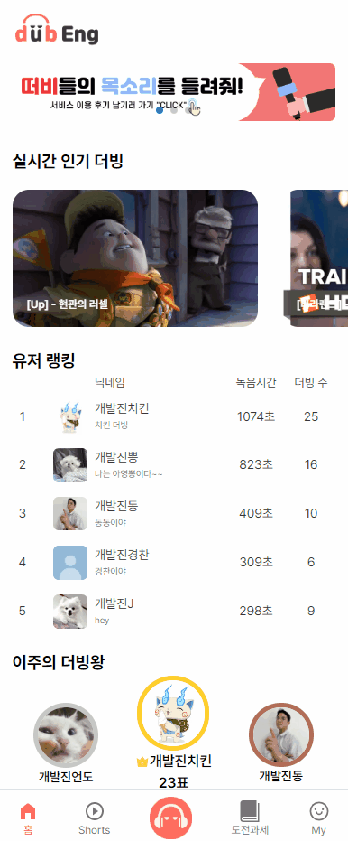
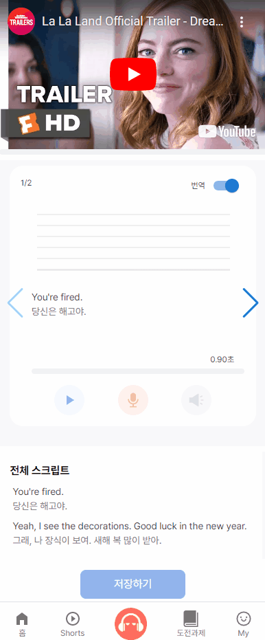
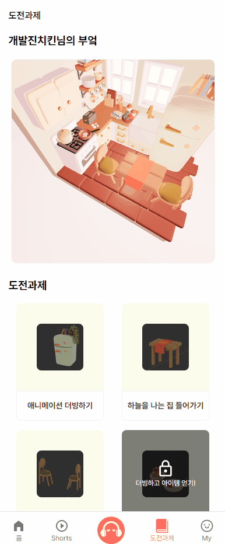
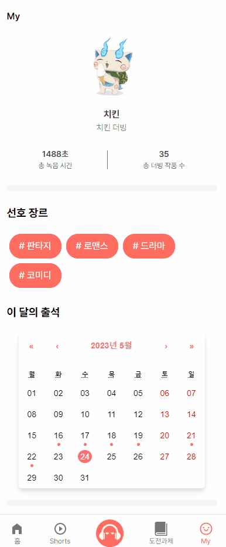
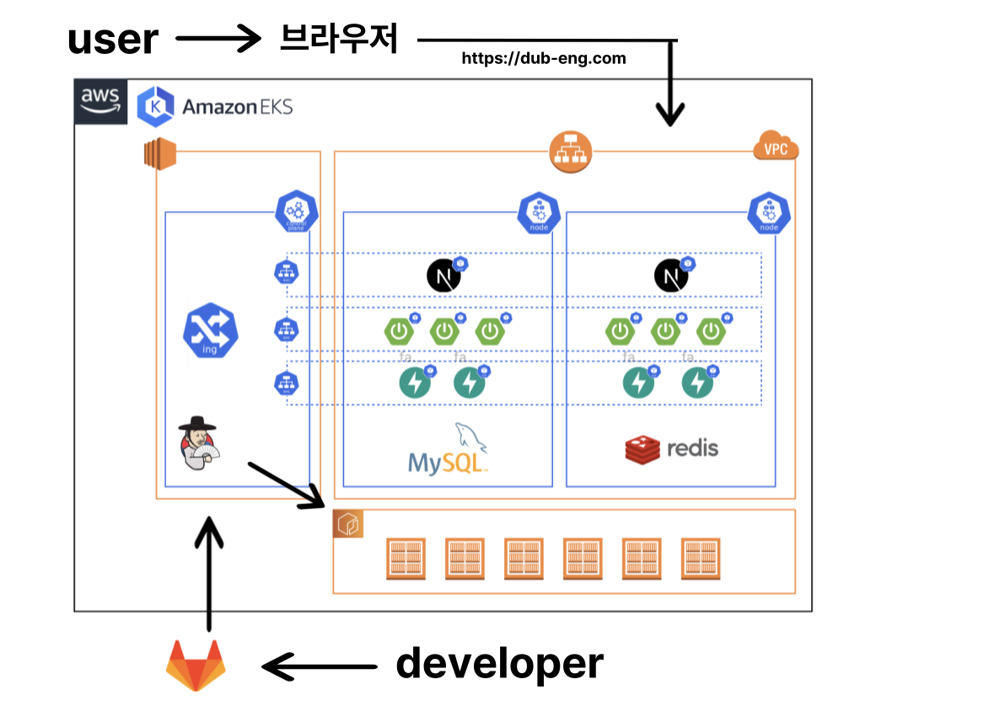
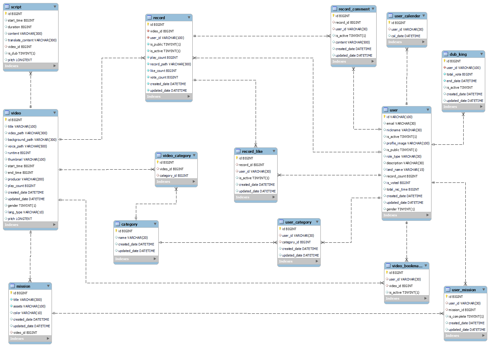
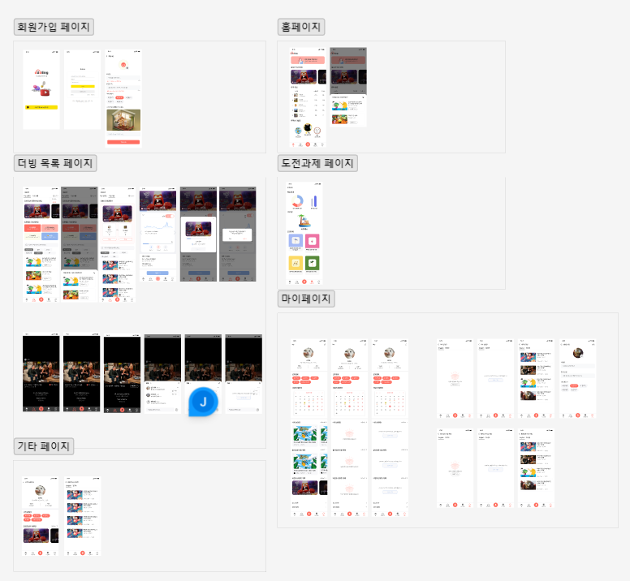
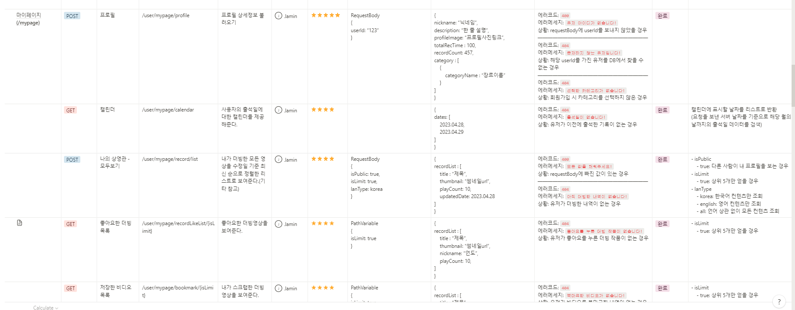

# 🎧 **Dubeng** 🎧


**영어로 연기하며 스피킹을 배우는 서비스**


</br>

## 🎯 프로젝트 소개 


🏷️ **프로젝트명** : **dubEng [덥잉]**

🏆 **SSAFY 프로젝트 경진대회 최우수상 수상**

👥 **회원수 160명 달성** 

🌍 **실 사용자 수 190명 돌파!**


<!--
📚 **컨설턴트님 pick! 팀 노션 구경하기** : [노션 바로가기](https://www.notion.so/DubEng-c6c68aaf2d5e4842b554c90864edaa45?pvs=4)
-->

<br>
<br>


## 🎤 서비스 이용해보기


🖥 **서비스 주소** : [dub-eng.com](https://dub-eng.com/)

🛍️ **Play Store** : [어플 다운받기(Android)](https://play.google.com/store/apps/details?id=com.dub_eng.twa&pcampaignid=web_share)

🎥 **소개 영상 보기** : [UCC 링크](https://youtu.be/w0EPj1LV1sI)

<br>
<br>

💖 **서비스 소개**

> **영어로 더빙하며 스피킹을 배우는 서비스**
> 
> 
> **Practice makes Perfect**
> 

- **따라읽기만 하던 영어는 이제 그만! ✋**
    
    영어 회화 실력을 늘리려면 매일 조금씩 꾸준히 영어로 말하는게 중요합니다. 기존의 영어 학습법은 단순히 단어 외우기, 문법 공부등 지루한 공부를 통해 배웁니다.
    
    덥잉 서비스는 더빙을 해봄으로써 재미있게 영어의 강세 습득 및 스크립트를 외우면서 자연스럽게 회화 스킬을 얻을 수 있습니다. 
    
    아직도 기계적으로 문제를 풀듯이 영어를 공부하고 계신가요? 소통을 위한 언어인 영어, DubEng과 함께 이제는 재미있게 배워보세요! 
    

- **다양한 콘텐츠 둘러보기 👀**
    
    관리자 페이지에서 직접 검수하기 때문에 양질의 영상 컨텐츠를 볼 수 있습니다. 
    
    다양한 카테고리와 검색을 통해 원하는 영상을 쉽게 검색할 수 있습니다.
    
    상황별 더빙하기를 통해 원하는 상황에서의 콘텐츠를 살펴보세요.
    
    ** 만약 내가 원하는 컨텐츠가 어떤건지 모르겠다면 더빙의 추천 알고리즘을 통해 원하는 콘텐츠를 추천 받아보세요. **
    
- **다양한 더빙작품 둘러보기 👀**
    
    오늘의 더빙왕은 누구에게 투표할 것인가요? 하루에 4번 더 잘하는 떠비들에게 투표할 수 있습니다. 
    
    매주 더빙왕이 업데이트 되기 때문에 여러분도 이주의 더빙왕에 등극할 수 있습니다.
    
- **더빙하기를 더 정확하게 📈**
    
    STT와 피치그래프를 통해서 내 발음이 정확한지 살펴볼 수 있습니다.
    
    더빙 완료 후 영상과 함께 미리보기를 재생하여 완성된 더빙을 미리 볼 수 있습니다.
    
    영화나 드라마속 다양한 배우들과 함께 대사를 주고 받으면서 여러분도 스타가 되어보세요.
    

👤 **서비스 대상**

- 단순히 읽기, 듣기, 쓰기 외에 **진짜 스피킹을 위한 영어**를 공부하고 싶으신 분
- **좋아하는 컨텐츠**를 즐기면서 자연스럽게 영어도 학습하고 싶으신 분
- 영어 시험 성적은 높지만 **스피킹 앞에서 한없이 작아지는 분**
- DubEng에서 좋아하는 컨텐츠의 주인공이 되어, 직접 **내 목소리를 녹음한 더빙 작품**을 만들어보세요!

☝🏻 **주요 기능**

- 홈
- 숏츠
- 목록
- 도전과제
- 마이페이지
- 더빙하기

🎠 **배포 환경**

- URL : [https://dub-eng.com/](https://dub-eng.com/)
- Play Store : [다운로드 하기](https://play.google.com/store/apps/details?id=com.dub_eng.twa&pcampaignid=web_share)
- 포팅 메뉴얼

🗓 **진행 일정**

- 2023.04.10 ~ 2023.05.31 (총 6주)
- 2023.06.01 ~ (진행중)

🚩 **프로젝트 요약**

| Application | Language | Framework |
| --- | --- | --- |
| ✅ Desktop Web | ✅ JavaScript | 🔲 Vue.js |
| ✅ Mobile Web | ✅ TypeScript | ✅ Next.js |
| 🔲 Responsive Web | 🔲 C/C++ | 🔲 Angular |
| ✅ Android App | 🔲 C# | 🔲 Node.js |
| 🔲 iOS App | ✅ Python | ✅ Flask/FastAPI |
| 🔲 Desktop App | ✅ Java | ✅ Spring/Springboot |

👨‍👧‍👧 **팀 소개 - 🙋‍♀️도비🙋‍♂️**

| [김아영](https://github.com/joen00) | [김도언](https://github.com/eondo) | [김동률](https://github.com/lancelot1672) | [김지희](https://github.com/4priltwntsx) | [백자민](https://github.com/sdflksjf2683) | [최정온](https://github.com/choijeongon) | [임경찬](https://github.com/rudcks5562) |
| --- | --- | --- | --- | --- | --- | --- |
| BE | FE | BE / Infra | BE | BE | FE | FE |

## 📢 주요 기능 📢

---

## 홈

**1️⃣ 실시간 인기 더빙**

- 조회수와 좋아요순으로 정렬된 더빙 작품

**2️⃣ 유저 랭킹**

- 녹음시간과 더빙 수로 정렬된 유저 랭킹 Top 5

**3️⃣ 이주의 더빙왕**

- 이번주 투표수가 가장 많은 유저 랭킹 Top 3



## 목록

- 영어 콘텐츠와 한국어 콘텐츠를 선택해서 볼 수 있습니다.
- 다양한 카테고리와 제목 검색을 통해 원하는 작품을 검색해보세요.

**1️⃣ 더빙 콘텐츠**

- 유저의 개인 맞춤 추천 콘텐츠를 추천받을 수 있습니다.
    - 카테고리, 제작사, 성별을 기반으로 가중치를 다르게 주어 원하는 콘텐츠를 추천받을 수 있습니다.
- “상황별로 더빙해봐요” 를 통해 주어진 상황에서의 더빙 콘텐츠들를 보여줍니다.

**2️⃣ 더빙 작품**

- 하루에 4번 더빙왕을 투표할 수 있습니다. 하나의 작품에 대해 2명의 유저가 경쟁하여 더빙왕이 될 수 있습니다.


## 숏츠

- 더빙된 작품을 숏츠 형태로 살펴보기


## 더빙하기

**1️⃣ 구간별 스크립트 더빙**

- 해당 구간을 재생하고 더빙할 수 있습니다.
- 피치 그래프와 STT를 통해 정확하게 더빙을 하고 있는지 볼 수 있습니다.
- 번역 토글을 통해 번역을 가릴 수 있습니다.

**2️⃣ 전체 스크립트**

- 해당 콘텐츠의 모든 스크립트를 볼 수 있습니다.

**3️⃣ 저장하기**

- 저장 후 미리 보기를 통해 잘 더빙이 됐는지 확인할 수 있습니다. 완벽하게 더빙이 됐으면 올려주세요.



## 도전과제

- 도전과제 페이지에 가면 완성해야 할 “나만의 부엌”과 “완료한 도전과제 리스트”를 확인할 수 있습니다.
- 특정 콘텐츠를 더빙하면 해당 콘텐츠에 매핑된 도전과제를 완료할 수 있습니다.
- 도전과제를 하나씩 완료하면 alert창과 함께 각 도전과제에 매핑된 에셋이 잠금 해제되고, 해제된 에셋은 나만의 부엌에 활성화됩니다.
- 도전과제를 모두 완료하면 나만의 부엌이 완성됩니다.




## 마이페이지

**1️⃣ 프로필 정보**

- 프로필 사진과 닉네임, 한 줄 소개, 총 녹음 시간, 총 더빙 작품 수 등 기본 프로필 정보를 확인할 수 있습니다.

**2️⃣ 선호 장르 및 출석 현황**

- 회원가입 시 선택했던 카테고리 장르를 확인할 수 있습니다.
- 캘린더에 출석 현황이 표시됩니다.

**3️⃣ 더빙/컨텐츠 목록**

- 나의 더빙 목록
    - 유저가 더빙한 더빙 목록을 모두 확인할 수 있습니다.
    - 해당 더빙 작품을 클릭하면 상세 페이지로 이동하여 작품을 재생해볼 수 있습니다.
    - 다른 사람이 내 프로필을 볼 때는 “공개” 설정한 더빙 작품만 보이게 됩니다.
    - 마이페이지에서는 상위 다섯개의 더빙 작품을 확인할 수 있고, 상세보기로 이동하면 영어/한국어 별로 나눠 확인할 수 있습니다.
- 좋아요한 더빙 목록
    - 유저가 좋아요를 누른 더빙 작품 목록을 확인할 수 있습니다.
    - 해당 더빙 작품을 클릭하면 상세 페이지로 이동하여 작품을 재생해볼 수 있습니다.
    - 마이페이지에서는 상위 다섯개의 더빙 작품을 확인할 수 있고, 상세보기로 이동하면 영어/한국어 별로 나눠 확인할 수 있습니다.
- 저장한 콘텐츠 목록
    - 유저가 북마크한 콘텐츠 목록을 확인할 수 있습니다.
    - 해당 콘텐츠를 클릭하면 상세 페이지로 이동하여 작품을 재생해볼 수 있습니다.
    - 마이페이지에서는 상위 다섯개의 콘텐츠를 확인할 수 있고, 상세보기로 이동하면 영어/한국어 별로 나눠 확인할 수 있습니다.



## 🔧 기술 스택 🔧

---

```jsx
**[ Backend ]**
- Java 11
- MySQL `8.0.30`
- SpringBoot `2.7.9`
- Spring Data JPA `2.7.9`
- Gradle `7.5`
- Lombok `1.18.26`
- Swagger `2.9.2`
- Spring Security `2.7.9`
- JWT `0.11.2`
- Python `3.10.10`

**[ Frontend ]**
- nodeJS: 18.16.0
- npm: 9.6.5
- react: 18.2.0
- next: 13.3.1
- react-query: ^3.39.3
- react-redux: ^8.0.5
- redux: ^4.2.1
- redux-persist: ^6.0.0
- tailwindcss: 3.3.2
- typescript: 5.0.4

**[ DB ]**
- MySQL `8.0.30`

**[ DevOps ]**
- Docker, containerd
- Nginx
- Jenkins
- AWS EC2
- AWS EKS, ECR, ALB, EFS

**[ Storage ]**
- S3 Bucket

**[ IDE ]**
- IntelliJ
- VSCode

**[ Team Collaboration Tool ]
-** GitLab
- Notion
- JIRA
- MatterMost
- Webex
- Gather
```

## 💥 아키텍처 💥

---



## 💾 ERD 💾

---



## 🎨 [와이어프레임](https://www.figma.com/file/Msveb7oPds2U2LY5FJ1BpM/%EB%8D%A5eng%EB%8D%A5ing?type=design&node-id=1-3&t=qM4juPakMBlRVNdt-0) 🎨

---



## 📜 [API 명세서](https://www.notion.so/a43bcf1b23784bad89f8930726acdf06) 📜

---



```
